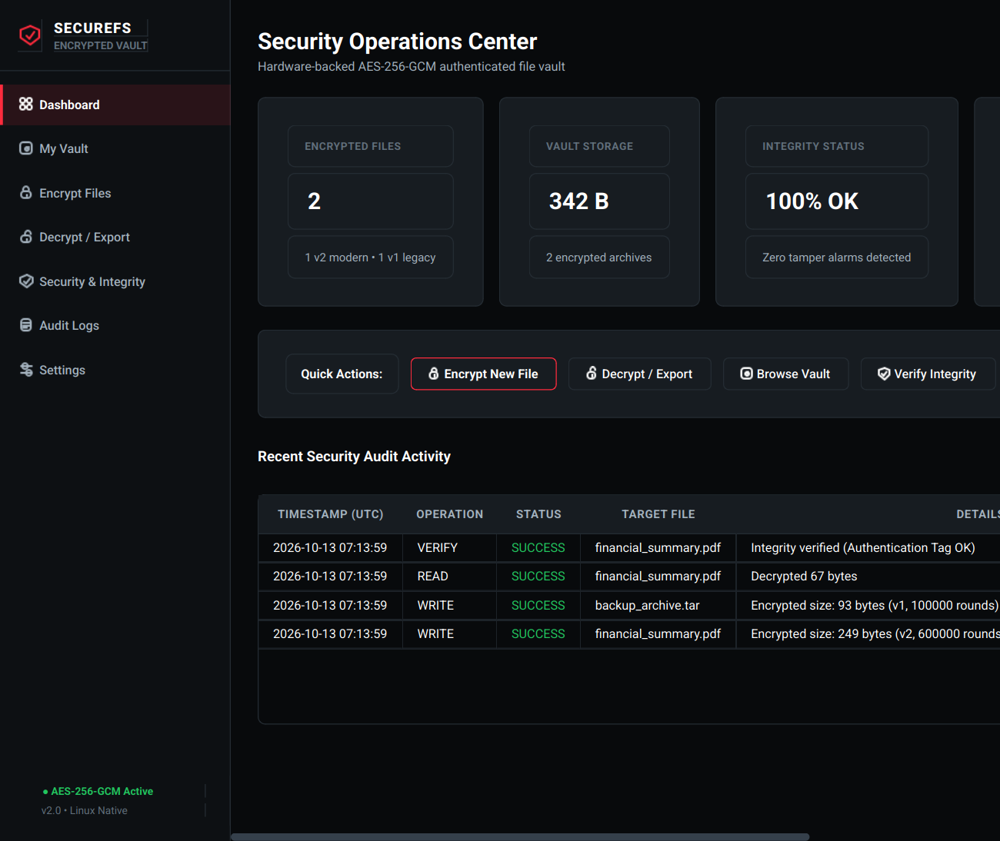
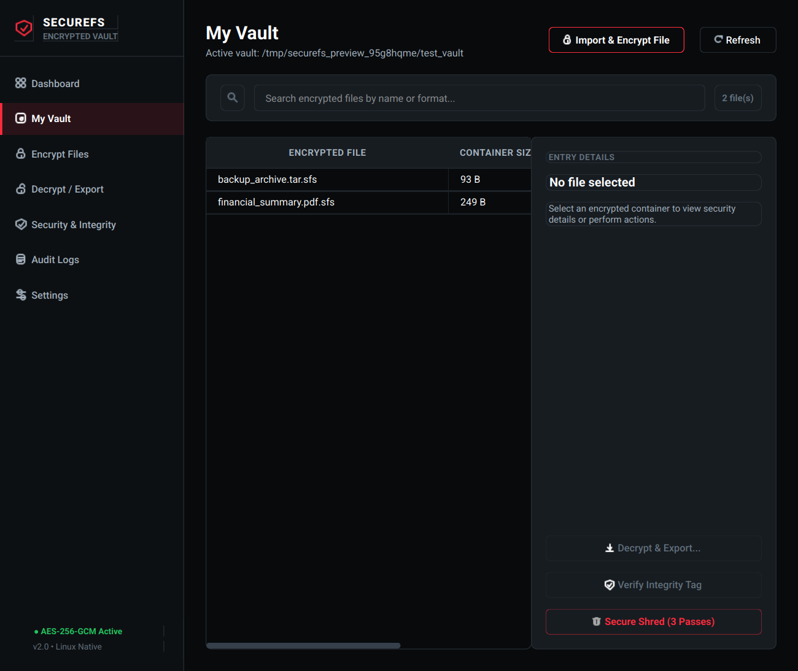
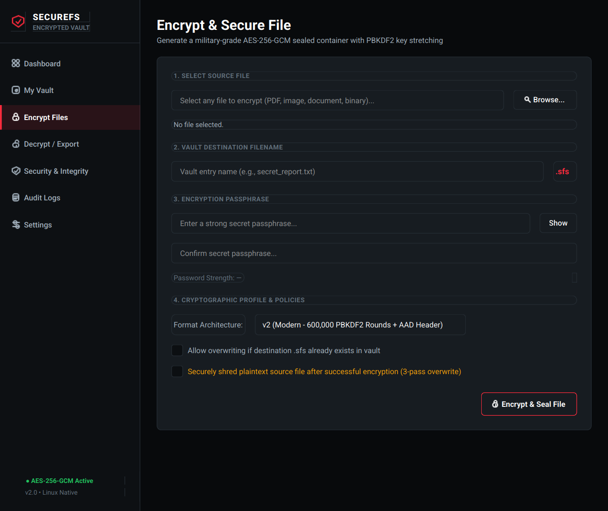
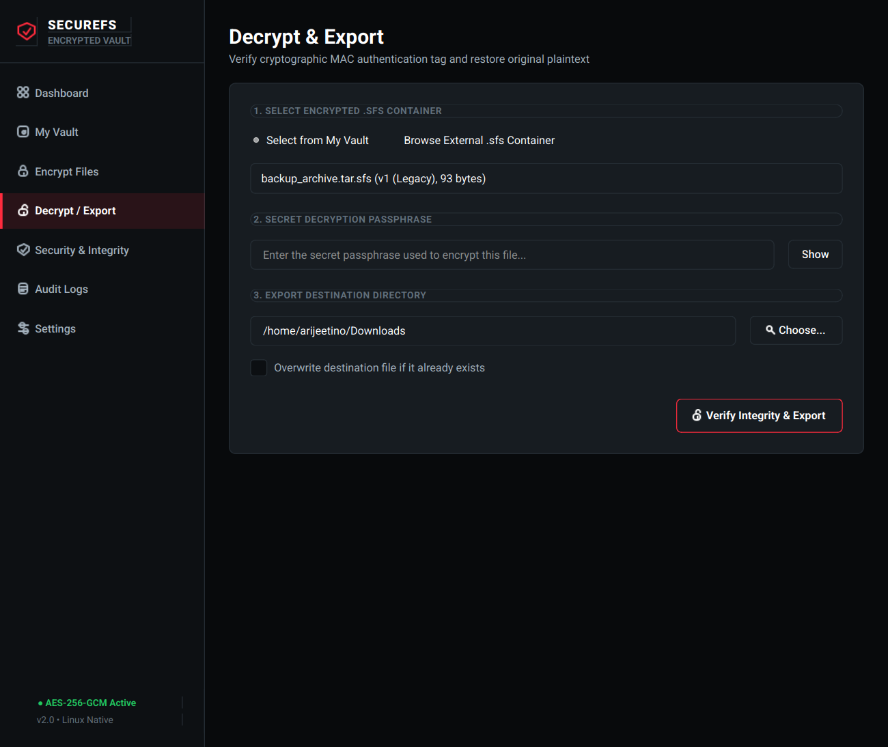
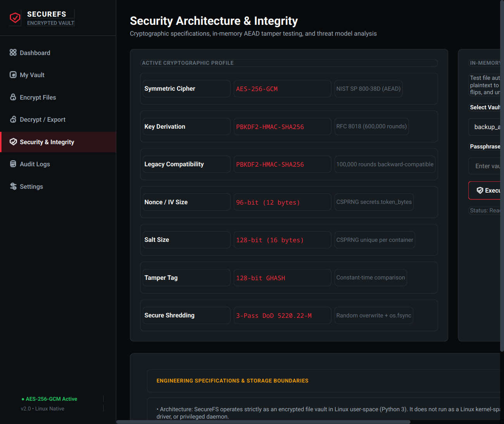
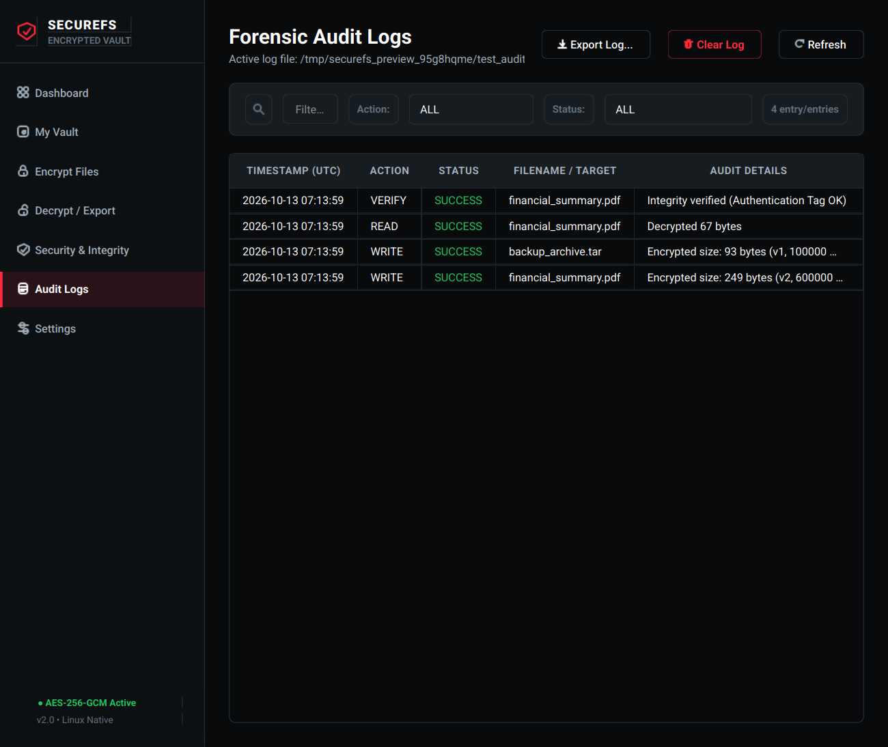

# 🛡️ SecureFS: Encrypted File Vault & Linux GUI

> **Project Title:** Designing Secure File Systems for Sensitive Data  
> **Domain:** Operating Systems & Cybersecurity (SIH 2026 / Academic Project)  
> **Language & Stack:** Python 3 (Pure Python) • PySide6 (Qt Native Linux GUI) • Cryptography  
> **Security Core:** AES-256-GCM (AEAD) • PBKDF2-HMAC-SHA256 (600,000 rounds v2 / 100,000 rounds v1) • Instant Tamper Detection • DoD 3-Pass Shredding  

---

## 📸 Modern Linux Desktop GUI

SecureFS includes a native Linux desktop application built with **PySide6 (Qt)** designed with a cybersecurity theme (deep black and charcoal palette, vivid red primary accents, crisp outlines, and clean typography).

| Dashboard Overview | My Vault Explorer |
|:---:|:---:|
|  |  |

| File Encryption Interface | Decrypt & Export |
|:---:|:---:|
|  |  |

| Security Architecture & Integrity | Forensic Audit Logs |
|:---:|:---:|
|  |  |

---

## 📖 Table of Contents
1. [What is SecureFS in Simple Words?](#-what-is-securefs-in-simple-words)
2. [Why Do We Need This? (The Real-World Problem)](#-why-do-we-need-this-the-real-world-problem)
3. [Key Features & Architecture](#-key-features--architecture)
4. [Container Formats (v2 Modern vs v1 Legacy)](#-container-formats-v2-modern-vs-v1-legacy)
5. [Installation & Requirements](#-installation--requirements)
6. [Launching the Linux GUI](#-launching-the-linux-gui)
7. [Running the Command-Line Demo](#-running-the-command-line-demo)
8. [Automated Testing & Verification](#-automated-testing--verification)
9. [Python API Tutorial](#-python-api-tutorial)
10. [Engineering Limitations & Security Considerations](#-engineering-limitations--security-considerations)
11. [Project Structure](#-project-structure)
12. [License & Disclaimers](#-license--disclaimers)

---

## 💡 What is SecureFS in Simple Words?

Standard computer filesystems (such as ext4 on Linux or NTFS on Windows) store your documents in plain unencrypted bytes. If a laptop is lost, or an offline attacker inspects the disk, they can read every word, modify configs, or recover deleted data.

**SecureFS acts as a high-security encrypted vault for sensitive files:**
- **Zero Plaintext on Disk:** Every file is encrypted using AES-256-GCM. Unreadable math noise is all that touches the storage media.
- **Cryptographic Tamper-Evident Seal:** Uses Authenticated Encryption with Associated Data (AEAD). If even a single byte or header bit is modified, SecureFS detects the broken authentication tag, aborts access, and alerts the audit trail.
- **3-Pass Secure Shredding:** When authorized deletion is requested, the container is overwritten 3 times with cryptographically secure random bytes followed by hardware cache flushing (`fsync`).
- **Append-Only Forensic Flight Recorder:** Every action (read, write, verification, deletion, or failed password attempt) is logged into an immutable JSON-lines ledger (`audit.log`).
- **Native Desktop GUI:** Complete Linux cybersecurity control center with background workers that prevent UI freezing during cryptographic key stretching.

---

## 🚨 Why Do We Need This? (The Real-World Problem)

| Normal Filesystem Weakness | What Actually Happens | How SecureFS Fixes It |
|---|---|---|
| **Plaintext Storage** | When saving `passwords.txt`, raw text sits on physical storage blocks. | **AES-256-GCM Encryption:** Only authenticated ciphertext ever touches the disk. |
| **Offline Hard Drive Theft** | An attacker can remove the SSD, mount it on another machine, and bypass OS authentication. | **Zero Plaintext on Disk:** Without the passphrase and PBKDF2 derivation, disk data remains unreadable. |
| **Silent File Tampering** | Malware or offline attackers can alter files (e.g., config files or financial records) silently. | **Cryptographic MAC Tag:** Every container has a 128-bit GHASH tag. Tampering causes an immediate security alarm. |
| **Fake "Delete" (Unlink)** | Standard delete only removes directory pointers; sectors can be recovered forensically. | **3-Pass Shredding:** Overwrites data with random bytes 3 times and executes `os.fsync()` before removal. |
| **No Audit Trail** | Standard filesystems do not log unauthorized offline access attempts. | **JSON-Lines Audit Log:** Captures ISO UTC timestamps, actions, targets, and security statuses. |

---

## ✨ Key Features & Architecture

### 1. 🔒 Authenticated Encryption (AES-256-GCM)
Files are encrypted in memory using AES-256 in Galois/Counter Mode (GCM).
- 256-bit symmetric encryption key derived per session.
- 96-bit (12-byte) unique random nonce (`secrets.token_bytes`) generated for every container.
- Authenticated Encryption with Associated Data (AEAD) seals container metadata into the authentication tag.

### 2. 🛡️ Industrial Key Stretching (PBKDF2-HMAC-SHA256)
- **v2 Format:** 600,000 computational rounds (OWASP recommended standard) with a 128-bit (16-byte) CSPRNG salt.
- **v1 Legacy Format:** 100,000 computational rounds supported for backward compatibility.
- Protects passphrases against fast offline GPU dictionary attacks.

### 3. 🚨 Instant Bit-Flip & Tamper Detection
- 16-byte GHASH authentication tag checked before deciphering.
- Raises `PermissionError` and logs `ALERT_TAMPER_OR_AUTH_FAIL` on corrupted headers, flipped bits, or wrong passwords.

### 4. 🌪️ Atomic Writes & Path Sanitization
- Encrypted data is written to a temporary hidden file in the vault, flushed, synced, and atomically replaced (`os.replace`) to prevent file corruption during sudden power failures.
- Path traversal sequences (`../`, `/`, null bytes) are stripped to prevent unauthorized directory escapes.

### 5. ⚡ Asynchronous GUI Workers
- PySide6 desktop interface runs PBKDF2 stretching, file encryption, decryption, and verification in background `QThread` workers. The UI never freezes or stutters.

---

## 📦 Container Formats (v2 Modern vs v1 Legacy)

SecureFS maintains backward compatibility with existing `.sfs` containers:

### 1. Modern Versioned Container (`v2`)
New files created in SecureFS v2 use an authenticated container format:
```text
┌─────────────────┬───────────────────┬─────────────────────┬──────────────┬──────────────┬───────────────────────────────┐
│ MAGIC: "SFS\x02"│ HEADER_LEN (2B)   │ HEADER JSON (UTF-8) │ SALT (16B)   │ NONCE (12B)  │ CIPHERTEXT + 16B GHASH TAG    │
│ (4 Bytes)       │ (uint16 big-end)  │ (Authenticated AAD) │ (Random CSP) │ (Random CSP) │ (AES-256-GCM Authenticated)   │
└─────────────────┴───────────────────┴─────────────────────┴──────────────┴──────────────┴───────────────────────────────┘
```
- The magic header and metadata JSON (iteration count, original filename, timestamp) are passed as **Associated Data (AAD)** to AES-GCM. Any modification to the metadata header invalidates the cryptographic tag!

### 2. Legacy Container (`v1`)
Existing `.sfs` files (such as `my_test.txt.sfs` and `confidential_project.txt.sfs`) are detected:
```text
┌─────────────────┬─────────────────┬──────────────────────────────────────────┐
│ SALT (16 Bytes) │ NONCE (12 Bytes)│ CIPHERTEXT + 16-BYTE AUTHENTICATION TAG  │
└─────────────────┴─────────────────┴──────────────────────────────────────────┘
```
- Derived with 100,000 PBKDF2 rounds. Seamlessly opened and verified without data loss.

---

## 🚀 Installation & Requirements

### System Requirements:
- **Operating System:** Linux (Ubuntu, Debian, Fedora, Arch Linux, openSUSE, etc.)
- **Python:** Python 3.8+ (Tested on Python 3.14)
- **Privileges:** Regular user account (No root / sudo required).

### Setup with Virtual Environment:
```bash
# 1. Clone repository and navigate to directory
git clone https://github.com/ArijeetKurse/SecureFS.git
cd SecureFS

# 2. Create virtual environment
python3 -m venv .venv
source .venv/bin/activate

# 3. Install dependencies
pip install -r requirements.txt
```

---

## 🖥️ Launching the Linux GUI

Launch the desktop vault using the provided script or Python directly:

```bash
# Option A: Using the launcher script
./run_gui.sh

# Option B: Direct execution
source .venv/bin/activate
python -m gui.main
```

### Optional Command-Line Arguments:
```bash
# Specify custom vault directory and audit log path:
python -m gui.main --storage-dir /path/to/my_vault --log-file /path/to/audit.log
```

---

## 🧪 Running the Command-Line Demo

To run the interactive CLI demonstration:
```bash
python3 demo.py
```
This runs a 6-phase security demonstration verifying encryption, raw disk inspection, password validation, bit-flip tamper detection, and audit log tracking.

---

## 🔬 Automated Testing & Verification

The project includes an automated test suite covering encryption edge cases, binary roundtrips, tampering, legacy file compatibility, and GUI thread workers:

```bash
# Run all unit and integration tests
pytest -v
```

### Test Coverage Highlights:
- Text, image, PDF, and arbitrary binary file encryption roundtrips.
- Correct vs incorrect passphrase rejection.
- Bit-flip tamper detection in ciphertext and AAD header.
- Truncated and malformed container handling.
- Legacy v1 format backward compatibility.
- Collision prevention and atomic overwrite safety.
- Path traversal attack prevention (`../../malicious.txt`).
- 3-pass secure shredding with `fsync`.
- Forensic audit log generation and parsing.
- PySide6 worker thread execution and GUI navigation.

---

## 💻 Python API Tutorial

You can integrate SecureFS into any Python workflow:

```python
from securefs import SecureFS

# Initialize vault
fs = SecureFS(storage_dir="my_vault", log_file="audit.log")

# 1. Encrypt and write file (v2 format with 600,000 PBKDF2 rounds)
path = fs.write_file(
    filename="financials.pdf",
    data=b"%PDF-1.7 Confidential Report Bytes...",
    password="SuperSecretPassword123!",
    overwrite=False
)

# 2. Decrypt and verify
try:
    plaintext = fs.read_file("financials.pdf", "SuperSecretPassword123!")
    print(f"Decrypted {len(plaintext)} bytes successfully.")
except PermissionError:
    print("Authentication failed: Wrong password or tampered file!")

# 3. In-memory integrity check without reading plaintext
is_valid, msg = fs.verify_integrity("financials.pdf", "SuperSecretPassword123!")
print("Integrity check:", is_valid, msg)

# 4. Secure shredding (3-pass overwrite + fsync)
fs.secure_delete("financials.pdf", "SuperSecretPassword123!")
```

---

## ⚠️ Engineering Limitations & Security Considerations

To ensure cryptographic and technical accuracy:

1. **User-Space Architecture:** SecureFS operates strictly in Python user-space as an encrypted vault application. It does **not** run as a Linux kernel module, virtual block-device driver, or FUSE mount.
2. **Flash Wear-Leveling Disclaimer (SSDs & NVMe):** The 3-pass shredding routine calls `os.fsync()` after each overwrite pass to force hardware disk controller cache flushing. However, on modern flash storage (SSDs, NVMe drives, USB flash drives), Flash Translation Layers (FTL) employ wear-leveling algorithms that dynamically remap underlying NAND flash blocks. User-space software cannot force physical NAND gate erasure without hardware-level ATA Secure Erase or NVMe Format commands.
3. **Copy-on-Write Filesystems:** On CoW filesystems (such as Btrfs, ZFS) or storage volumes with active snapshots, file overwriting creates new storage blocks rather than modifying physical blocks in place.
4. **Key Management:** Plaintext passphrases and derived keys exist temporarily in process RAM during cryptographic operations and are discarded immediately. Zero passwords or master keys are ever written to disk or recorded in audit trails.

---

## 📁 Project Structure

```text
.
├── securefs.py                       # Hardened encryption & storage backend engine
├── demo.py                           # Command-line presentation demonstration
├── run_gui.sh                        # Linux executable GUI launcher script
├── requirements.txt                  # Python dependencies (PySide6, cryptography, pytest)
├── pytest.ini                        # Automated test runner configuration
│
├── gui/                              # Native Linux PySide6 GUI Package
│   ├── main.py                       # GUI application entry point & CLI parser
│   ├── main_window.py                # MainWindow & sidebar navigation layout
│   ├── styles/                       # Centralized dark & red cybersecurity theme
│   │   ├── __init__.py
│   │   └── theme.py                  # Stylesheet tokens & minimal vector icon factory
│   ├── services/                     # Background workers & Qt service layer
│   │   ├── __init__.py
│   │   └── vault_service.py          # QThread workers (Encrypt, Decrypt, Verify, Shred)
│   └── pages/                        # Modular application views
│       ├── __init__.py
│       ├── dashboard_page.py         # Metrics, quick actions, and recent audit activity
│       ├── vault_page.py             # Vault inventory, search, import, export & shred
│       ├── encrypt_page.py           # Encryption interface with password strength meter
│       ├── decrypt_page.py           # Decrypt & export interface with tamper alert
│       ├── security_page.py          # Cryptographic profile, AEAD verifier & disclaimers
│       ├── audit_page.py             # Forensic JSON-lines audit trail viewer
│       └── settings_page.py          # Storage paths, confirmation preferences & version
│
├── tests/                            # Automated Pytest Suite
│   ├── test_securefs_backend.py      # Backend unit tests (ciphers, tamper, shred, v1/v2)
│   └── test_gui_integration.py       # GUI integration tests (workers, pages, navigation)
│
├── scripts/
│   └── capture_previews.py           # Safe, isolated GUI preview screenshot capturer
│
├── artifacts/
│   └── gui-previews/                 # Generated GUI preview screenshots
│
├── encrypted_storage_demo/           # Demonstration encrypted vault containers (.sfs)
├── audit_demo.log                    # Demonstration audit log
└── README.md                         # Comprehensive documentation (this file)
```

---

## 📜 License

This project is licensed under the **MIT License**. Created for academic evaluation and operating systems security demonstration (SIH 2026).
